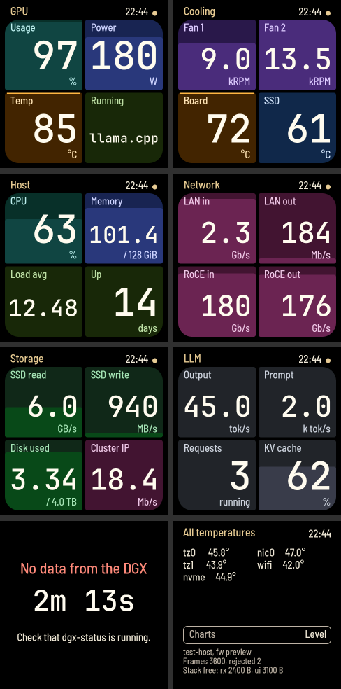

# dgx-status-display

[](https://github.com/evanwtf/dgx-status-display/actions/workflows/check.yml?query=branch%3Amain)
[](https://github.com/evanwtf/dgx-status-display/releases/latest)
[](LICENSE)
[](https://www.python.org/downloads/release/python-3130/)
[](https://github.com/espressif/esp-idf/releases/tag/v5.5.6)
[](https://docs.waveshare.com/ESP32-C6-Touch-AMOLED-2.16)

A live status screen for a DGX Spark. A Waveshare ESP32-C6-Touch-AMOLED-2.16
plugs into a USB-C port on the Spark. A small Python daemon on the Spark
sends one JSON frame per second over USB serial, and the board draws it:
GPU use, power and temperature, what is on the GPU, memory, CPU, fans and
every temperature sensor. When the frames stop, the screen says so.

Phase 1 is USB serial only. See [docs/plan.md](docs/plan.md) for phase 2
(Wi-Fi, outlet power, both Sparks) and [docs/protocol.md](docs/protocol.md)
for the frame format.

## Requirements

- **Linux with Docker.** Docker must work for your user (`docker ps`). The
  firmware builds and flashes in the pinned ESP-IDF image. The first build
  pulls it once: about 5.4 GB to download, 9.2 GB on disk.
- **[uv](https://docs.astral.sh/uv/).** It fetches Python 3.13 itself.
- **git** and **GNU make**.
- **A DGX Spark, for real data.** The daemon reads NVML, `/proc` and the
  hwmon sensors of the Spark it runs on. The fan readings need the
  `nvfanread` hwmon module from
  [evanwtf/dgx-spark-fan-override](https://github.com/evanwtf/dgx-spark-fan-override).
  Without it, the fan tiles show `—`.
- **The board:** a
  [Waveshare ESP32-C6-Touch-AMOLED-2.16](https://docs.waveshare.com/ESP32-C6-Touch-AMOLED-2.16)
  and a USB-C cable (see [Hardware](#hardware)).

### The firmware builds in a container

Every firmware step (build, tests, preview, merge, flash, backup, core dump)
runs in the `espressif/idf:v5.5.6` image, pinned by digest. This is the
supported path. `scripts/firmware.py` is the one place that holds the
digest; the make targets and CI call that script. The image is multi-arch
(`linux/amd64` and `linux/arm64`), so the same pin builds on the Spark
(arm64) and on an x86-64 machine.

A local ESP-IDF install also works, but only if it is exactly v5.5.6 with
the components that `firmware/dependencies.lock` locks. Other versions are
not tested.

## Quick start with make

From a bare DGX Spark to a running display. `make` with no target lists
every target. The board targets read `PORT`, the board's stable serial
path. They run esptool in the container with `--device`, so they need no
sudo and no `dialout` group.

```bash
export REPO=~/git/dgx-status-display
git clone https://github.com/evanwtf/dgx-status-display "$REPO"
cd "$REPO"
# The board's port. Its name holds the chip's MAC, so find it:
export PORT=$(ls /dev/serial/by-id/usb-Espressif_USB_JTAG_serial_debug_unit_*-if00)
echo "$PORT"           # must print exactly one path
make setup             # uv sync --frozen, pre-commit install
make check             # ruff, mypy, pytest
make fw-build          # idf.py build in the container
```

Back up the factory firmware once, before the first flash:

```bash
make backup            # save the whole flash to backup/
```

Check that it succeeded before you go on. It must log a 16 MB flash, with
secure boot and flash encryption off, and end with "backed up the flash".
`backup/factory-16MB.bin` and its `.sha256` must exist. The flash targets
refuse without a backup that matches its `.sha256`.

```bash
make flash-merged      # first install: erases the board's settings
make dry-run           # log one frame; opens no device
make install-service   # asks for your sudo password; run make as yourself
```

The board restarts and shows "DGX not sending" after the flash. After the
service starts, the screen shows LIVE. Read each step in
[Bootstrap, step by step](#bootstrap-step-by-step) before you run it the
first time.

### Update

The service holds the port, so stop it before you flash:

```bash
cd "$REPO"
git pull --ff-only
make setup
make fw-build
sudo systemctl stop dgx-status
make flash             # keeps the board's settings
sudo systemctl start dgx-status
```

The board targets refuse while the service runs.

If `make fw-build` stops with "stale firmware/sdkconfig", delete
`firmware/sdkconfig` and run it again. A sdkconfig from an older build
keeps old settings; far mode needs new ones.

## Hardware

- **Board:** [Waveshare ESP32-C6-Touch-AMOLED-2.16](https://docs.waveshare.com/ESP32-C6-Touch-AMOLED-2.16).
  A 2.16-inch 480×480 AMOLED (CO5300 driver, QSPI), CST9220 capacitive
  touch, an AXP2101 power chip and an ESP32-C6 with 16 MB flash and no PSRAM.
- **Link:** one USB-C cable to the DGX Spark. It carries power and the
  frames (the C6's built-in USB-Serial-JTAG). No Wi-Fi in phase 1.
- **Host:** an NVIDIA DGX Spark (GB10). The fan readings need the
  `nvfanread` hwmon module.

Far mode (the default) shows GPU use, power and temperature, LLM output,
the model or what is on the GPU, memory and CPU, one per page, readable
from 2 m. Near mode adds load, fan speeds, board and NVMe temperatures,
network and storage rates, uptime and the host's clock. In both modes, a
long press opens a page with every temperature sensor.

## Bootstrap, step by step

The quick start, one step at a time, with the checks for each step. The raw
commands behind each target are in
[What the targets run](#what-the-targets-run).

### 1. Set the variables

```bash
export REPO=~/git/dgx-status-display
export PORT=$(ls /dev/serial/by-id/usb-Espressif_USB_JTAG_serial_debug_unit_*-if00)
echo "$PORT"                         # must print exactly one path
```

### 2. Get the code and check the daemon

```bash
if [ -d "$REPO/.git" ]; then git -C "$REPO" pull --ff-only; \
  else git clone https://github.com/evanwtf/dgx-status-display "$REPO"; fi
cd "$REPO"
make setup
make dry-run
```

The dry run logs one frame and opens no device. Check it: `occ` matches
`nvidia-smi`, `mem_used_gib` is MemTotal − MemAvailable, and `fan0_rpm` and
`fan1_rpm` are there (they need the `nvfanread` hwmon module).

### 3. Back up the factory firmware

Do this once, before the first flash.

```bash
cd "$REPO"
make backup
```

`make backup` runs four esptool commands. Each resets the chip into its
bootloader, and then back into the factory app, so the factory screen
comes back after each one:

1. `flash_id`: read its log. It must report a 16 MB flash.
2. `get_security_info`: secure boot and flash encryption must be off.
3. `read_flash`: read all 16 MB to `backup/factory-16MB.bin`.
4. `verify_flash`: read the chip again and compare.

Then it checks the size (16777216 bytes) and writes
`backup/factory-16MB.bin.sha256`. It refuses to replace a backup that
exists. `make flash` and `make flash-merged` refuse unless both files exist
and match. To flash with no backup, add `NO_BACKUP=1`; do this only if you
have a copy of the factory image elsewhere.

Stop if `get_security_info` shows secure boot or flash encryption enabled:
this firmware is unsigned and the flash would not boot. Git ignores
`backup/`. Copy `factory-16MB.bin` and its `.sha256` off this machine too.
Waveshare also publishes its factory image (`03_Firmware/01_Fac-v1.0.0.bin`
in [waveshareteam/ESP32-C6-Touch-AMOLED-2.16](https://github.com/waveshareteam/ESP32-C6-Touch-AMOLED-2.16)).

### 4. Build and flash the firmware

The first flash happens before the service exists, so nothing else holds the
port.

```bash
cd "$REPO"
make fw-test           # host unit tests
make fw-build          # idf.py build in the container
make flash-merged      # merge, then write the one image at 0x0
```

The board restarts and shows "DGX not sending". `flash-merged` erases the
board's stored settings (the screen rotation, the chart style and the
display mode, which goes back to far). Use it for a first install; later,
`make flash` keeps them.

**If esptool cannot connect** (for example, the firmware on the chip has
taken over USB): unplug the board, hold **BOOT**, plug it back in, release
BOOT. The chip now waits in its bootloader. Run the raw flash command (see
[What the targets run](#what-the-targets-run)) with `--before no_reset` in
place of `--before default_reset`. Then replug the board: it has no reset
button.

### 5. Install the service

`deploy/dgx-status.service` is a template. `make install-service` fills in
`@USER@` (the account that runs the daemon, `$USER` by default; set
`SERVICE_USER` to change it) and `@REPO@` (this checkout) in a temporary
file (`scripts/service.py`). Then it installs the unit with
`sudo install -m 0644`, and runs `daemon-reload`, `enable` and `restart`, so
a new unit also reaches a running service. It prints each sudo command
before it runs it. Run make as yourself, not with sudo: it refuses root.
It refuses a checkout path that holds a space, `|`, `&`, `'` or `\`. It
refuses to replace a unit that serves another checkout, unless you add
`FORCE=1`. The unit adds `dialout` for this service only. The daemon finds the board's port itself; to pin one port,
put `DGX_STATUS_DEVICE=...` in `/etc/default/dgx-status`.

The network and storage tiles find their sources each second. Set one of
these in the same file only when the automatic choice is wrong
(`.env.example` lists them all):

| Variable | Default |
| --- | --- |
| `DGX_STATUS_LAN_IFACE` | the interface with the default route |
| `DGX_STATUS_ROCE_PORTS` | every RDMA port on an Ethernet link layer, as `device/port` |
| `DGX_STATUS_CLUSTER_IFACES` | every `mlx5_core` interface |
| `DGX_STATUS_SSD_DISK` | the disk that holds `DGX_STATUS_DISK_PATH` (`nvme0n1`) |
| `DGX_STATUS_DISK_PATH` | `/` |
| `DGX_STATUS_LLM_URL` | `http://127.0.0.1:9109/metrics`, the local LLM metrics exporter; `off` reports no engine up, so the board hides the LLM page |

```bash
cd "$REPO"
make install-service
journalctl -u dgx-status -f
```

Within a few seconds the log shows `connected to /dev/serial/by-id/...`, and
`display says hello: dgx-status-display, fw <version>`, and the screen shows
LIVE. `make uninstall-service` stops, disables and removes the unit.

## Install from a release

Each [release](https://github.com/evanwtf/dgx-status-display/releases) holds
the built firmware, so you need no firmware build. The daemon comes from a
clone of the same tag, with its locked dependencies. These steps take the
place of bootstrap steps 2 and 4. Do step 1 (the variables) first, and set
`DEV` and `IDF_IMAGE` as in [Without make](#without-make).

The make targets came in 0.0.3. For an older tag, use the raw command
that each step names.

Get the daemon at the release tag and check it. This replaces step 2:

```bash
# The latest release:
export VERSION=$(curl -fsSL https://api.github.com/repos/evanwtf/dgx-status-display/releases/latest \
  | python3 -c 'import json, sys; print(json.load(sys.stdin)["tag_name"].removeprefix("v"))')
git clone --branch "v$VERSION" https://github.com/evanwtf/dgx-status-display "$REPO"
cd "$REPO" && uv sync --frozen --no-dev
uv run --frozen --no-dev dgx-status --version
uv run --frozen --no-dev dgx-status --dry-run --once
```

Do step 3 now (back up the factory firmware): `make backup` for 0.0.3 or
later (its `uv run` adds the dev tools to `.venv`), or the raw backup
commands in [Without make](#without-make) for an older tag. Then download
the firmware and check it:

```bash
mkdir -p "$REPO/release" && cd "$REPO/release"
BASE=https://github.com/evanwtf/dgx-status-display/releases/download/v$VERSION
for f in SHA256SUMS "dgx-status-display-$VERSION-esp32c6-merged.bin" \
    "dgx-status-display-$VERSION-esp32c6.zip"; do curl -fsSLO "$BASE/$f"; done
sha256sum --ignore-missing -c SHA256SUMS    # each file must say OK
```

**First install:** flash the merged image at 0x0. It holds the bootloader,
the partition table and the app, with 0xFF between them. It erases the
board's stored settings (the screen rotation, the chart style and the
display mode, which goes back to far), so use it only for a first install:

```bash
docker run --rm --device="$DEV" -v "$REPO/release:/release:ro" -w /release "$IDF_IMAGE" \
  esptool.py --chip esp32c6 -p "$DEV" -b 460800 --before default_reset --after hard_reset \
  write_flash 0x0 "dgx-status-display-$VERSION-esp32c6-merged.bin"
```

Then install the service (step 5): `make install-service` for 0.0.3 or
later, or the raw commands at the end of [Without make](#without-make).

**Upgrade:** flash the parts from the zip with `flash_args`. This writes only
the bootloader, the partition table and the app, so the settings stay. The
service holds the port, so stop it first:

```bash
cd "$REPO/release"
python3 -m zipfile -e "dgx-status-display-$VERSION-esp32c6.zip" .
sudo systemctl stop dgx-status
docker run --rm --device="$DEV" -v "$REPO/release:/release:ro" \
  -w "/release/dgx-status-display-$VERSION-esp32c6" "$IDF_IMAGE" \
  esptool.py --chip esp32c6 -p "$DEV" -b 460800 --before default_reset --after hard_reset \
  write_flash "@flash_args"
sudo systemctl start dgx-status
```

To upgrade the daemon too, check out the new tag in `$REPO` and run
`uv sync --frozen --no-dev` before you start the service.

The release also has `dgx-status-display-$VERSION-esp32c6.elf` to decode a
core dump (`scripts/firmware.py coredump --elf`), the wheel and the sdist,
and `dgx-status.service`. `SHA256SUMS` covers every file.

## Build on another machine

- **The firmware builds on any Linux or macOS machine with Docker.** Clone
  the repo, then `make setup` and `make fw-build` (then `make fw-merge` for
  the one image). macOS ships GNU make 3.81; if a target fails with it,
  install a newer one (`brew install make`) and run `gmake`.
- **On macOS, Docker cannot pass a USB device into a container**, so the
  board targets do not work there. Flash with esptool on the host instead.
  `uvx` runs it without an install; use the same esptool version as the
  image (4.12.0). The port is `/dev/cu.usbmodem...`.

  First install, the merged image (erases the board's settings):

  ```bash
  export PORT=$(ls /dev/cu.usbmodem*)    # must be exactly one path
  make fw-merge
  uvx --from esptool==4.12.0 esptool.py --chip esp32c6 -p "$PORT" -b 460800 \
    write_flash 0x0 firmware/build/dgx_status_display-merged.bin
  ```

  Update, the parts from `flash_args` (keeps the settings):

  ```bash
  cd "$REPO"
  cd firmware/build
  uvx --from esptool==4.12.0 esptool.py --chip esp32c6 -p "$PORT" -b 460800 \
    write_flash @flash_args
  ```

- **The daemon runs only on the Spark that it reports on.** It reads that
  machine's `/proc`, `/sys` and NVML. Plug the board into that Spark.

## Serial port access

The port is `root:dialout 0660`. Pick one:

- **The service (default):** `SupplementaryGroups=dialout` in the unit. Your
  user stays out of `dialout`.
- **Manual runs as your user:** `sudo usermod -aG dialout "$USER"`, then log
  out and in. Then `make run` (or `make run PORT="$PORT"` to pin a port).

## Update the firmware

Once the service runs, it holds the port. Stop it for every board target,
and start it again afterwards.

```bash
cd "$REPO"
git pull --ff-only
make setup
make fw-build
sudo systemctl stop dgx-status
make flash
sudo systemctl start dgx-status
```

If the build stops with "stale firmware/sdkconfig", run
`rm firmware/sdkconfig` and build again.

`make monitor` shows the board's own log (`idf.py monitor --no-reset`;
Ctrl-] quits). It also needs the service stopped.

## Read a crash

The board's own log comes over USB, and the daemon relays its errors and
warnings, and every reboot, to the journal (`journalctl -u dgx-status`). The
board also keeps a core dump in flash after a panic or a watchdog reset, and
its next hello says why it reset. To read
the dump (esptool resets the chip, so stop the service first):

```bash
cd "$REPO"
sudo systemctl stop dgx-status
make coredump ELF=firmware/elf/dgx_status_display-<elf>.elf
sudo systemctl start dgx-status
```

`<elf>` is the `elf` value from the hello line in the daemon log. Without
`ELF` the step uses the current build's ELF. It prints the panic reason,
the crashed task and its backtrace, and saves the raw core in
`firmware/coredump/`; `uv run python scripts/firmware.py coredump --core <file>`
decodes a saved core again without the board.

## Restore the factory firmware

These commands need `DEV` and `IDF_IMAGE` from
[Without make](#without-make). The chain stops at the first failure, so
the service stays enabled if the restore fails.

```bash
sudo systemctl stop dgx-status        # if the service is installed
cd "$REPO/backup" && sha256sum -c factory-16MB.bin.sha256 && cd "$REPO" \
  && docker run --rm --device="$DEV" -v "$REPO:/project" -w /project "$IDF_IMAGE" \
    esptool.py --chip esp32c6 -p "$DEV" -b 460800 write_flash 0 backup/factory-16MB.bin \
  && sudo systemctl disable dgx-status   # the factory app does not read frames
```

## What the screen shows

The panel is about 40 mm across. It has two modes, and a short press of
**BOOT** switches between them:

- **Far** (the default): one metric per page, sized to read from 2 m.
- **Near**: six pages of four colored tiles.

Both cycle every 10 seconds, with a 0.3 s fade through black between pages.

In both modes, the LLM page shows only while the daemon reads at least one
engine up from the LLM metrics exporter. The exporter must listen on
loopback (the daemon refuses any other address). While the exporter is
down, or too slow to answer for 15 s, the page hides.

### Far mode

Each page shows one word, one value and its unit, over the metric's level
fill across the whole screen. Sizes come from an eye chart read on the
board at 2 m: words have 100 px capitals (81 px when a word is too wide),
values have 141 px digits (109 px for 4 or more characters), units have
81 px capitals, and names have 100 px capitals when they fit and 81 px
when they do not. All text is upper case, so no letter is smaller.
There is no clock and no page dot: neither is readable from 2 m.

| Page | Shows |
| --- | --- |
| GPU | Usage %, fill to 100 % |
| GPU PWR | GPU power in W, fill to 240 W |
| GPU TEMP | GPU °C, blue, then amber from 80 °C, red from 90 °C; fill from 20 to 100 °C |
| LLM | Output tok/s or k tok/s, no fill. Only while an engine is up. |
| MODEL | The first engine's model, without the `org/` part, and `+N` for N more engines. With no engine up, RUNNING and the GPU's backend (`vllm`, `llama.cpp`). Hidden when no engine is up and the GPU is idle or unknown. A long name takes two lines and ends in `...` if it still does not fit. A character outside ASCII shows as `?`. |
| MEMORY | GiB used, `/ 128 GIB` as the unit, fill to the total |
| CPU | CPU %, fill to 100 % |

A missing reading is `—`. While the link is STALE, the value turns amber
and the fill goes away. With **2-minute history** chosen (detail page), the
fill becomes the metric's chart across the screen. NO DATA has an 81 px
heading.

### Near mode

Six pages of four colored tiles. Each tile has a label, one value and a
unit.

| Page | Tiles |
| --- | --- |
| GPU | Usage %, Power W, Temp °C, Running (`idle` or the backend) |
| Cooling | Fan 1 and Fan 2 in kRPM (2700 RPM shows as `2.7`), Board °C, SSD °C |
| Host | CPU %, Memory used (`/ 128 GiB`, the memory installed, as the unit), Load avg, Up |
| Network | LAN in, LAN out (against the link speed), RoCE in, RoCE out (against 200 Gb/s), in kb/s, Mb/s or Gb/s |
| Storage | SSD read, SSD write (against 14 GB/s), in MB/s or GB/s; Disk used in TB (`/ 4.0 TB` as the unit); Cluster IP (kernel IP traffic on the ConnectX-7, in + out) |
| LLM | Output and Prompt in tok/s or k tok/s, Requests running, KV cache % (with a fill), summed over the engines that are up. Read from the local LLM metrics exporter. Long-press on this page for the models, the time to first token and the draft-token acceptance. |



- **Color carries the reading.** Usage, Power, the fans, CPU and Memory fill
  from the bottom to the value's fraction (Power against 240 W), and the
  fill eases to a new level in 400 ms. Temperature tiles turn from blue to
  amber at the threshold and red above it, with a bright edge on top:
  GPU 80 / 90 °C, board and SSD 70 / 80 °C.
- **Rates are instant.** Each network and SSD figure is the counter's change
  over the last second, never an average. A counter that resets, or an
  interface that comes or goes, shows a dash for one frame. Network tiles
  are rose, storage tiles green.
- **Charts (option):** on the detail page (long press), the "Charts" row
  switches between **Level** (the default) and **2-minute history**: the
  tile's background becomes an area chart of its last 120 one-second
  samples, on a fixed scale (0–100 %, 0–240 W, 0–13500 RPM, 0–total GiB,
  20–100 °C, 0–link speed, 0–200 Gb/s, 0–14 GB/s; Disk used has no chart). A missing reading or a NO DATA period is a gap. The numbers
  stay the instantaneous reading. The choice survives a reboot (NVS). The
  history lives on the board and starts empty after a reboot.
- **Top strip:** the page title, the host clock and a link dot (gold LIVE,
  amber STALE with the age).
- **Touch:** a tap moves to the next page and restarts the 10-second timer.
  A long press opens every temperature sensor; a tap or 20 seconds goes back.
- **Buttons:** a short press of **KEY** (released within 1 s) turns the screen 90° clockwise, so the board can stand on any
  edge. The angle survives a reboot (NVS), and touch follows it. A short
  press of **BOOT** switches between far and near mode, with a fade; the
  mode survives a reboot (NVS), and a board with no stored mode starts in
  far mode. PWR has no action; the board logs every press. Holding PWR does
  not switch the board off: unplug it.
- **NO DATA** (no frame for over 10 s): the carousel stops; a black, dimmed
  screen says "No data from the DGX" and how long ago the last frame came.
- **Type:** values in JetBrains Mono, right-aligned against a fixed edge with
  fixed decimals, so the last digit keeps its column; words in Barlow Semi
  Condensed. Every text color passes a contrast test (values 7:1, labels
  4.5:1) over every shade it can sit on.
- **Burn-in care:** black ground and gutters, the layout moves along a
  10-pixel orbit every 3 minutes, a gentle dim after 10 minutes with no
  change, and the pages put different hues in the same places.

Each value is one instantaneous reading. An unknown value shows `—`.

## Development

```bash
make setup
make check          # ruff format --check, ruff check, mypy, pytest; reports every failure
make fw-test
make fw-build
make fw-preview     # render the UI to firmware/preview/*.png
make fonts-check    # the fonts regenerate byte for byte
make clean          # remove build outputs; keeps backup/ and firmware/elf/
uv run python scripts/readme_image.py       # refresh docs/img/pages.png from the preview
```

The preview compiles the real `view.c` with the same LVGL version and
settings as the firmware, on the host, and renders each page to a PNG. It
fails if a value's last digit changes column between two values.

`tests/fixtures/spark/` holds /proc and /sys files copied from a DGX Spark.
`scripts/capture_fixtures.py` copies a fresh set, read-only.

## What the targets run

The Makefile is a thin wrapper. Each target runs one of these from the
checkout, so it works from any directory (`make -C "$REPO" fw-build`).
`make -n <target>` prints the commands without running them.

| Target | Runs |
| --- | --- |
| `setup` | `uv sync --frozen`, `uv run --frozen pre-commit install` |
| `check` | `uv run --frozen python scripts/run_checks.py`: `ruff format --check .`, `ruff check .`, `mypy`, `pytest -q -rs`, then pytest `-m 'not integration and not slow'`, which must skip nothing; every step runs |
| `test` | `uv run --frozen pytest -q -rs` |
| `fw-test`, `fw-build`, `fw-size`, `fw-preview`, `fw-merge` | `uv run --frozen python scripts/firmware.py test`, `build`, `size`, `preview`, `merge` |
| `fonts-check` | `uv run --frozen python scripts/gen_fonts.py --check` |
| `backup`, `flash`, `flash-merged`, `monitor` | `scripts/firmware.py backup`, `flash`, `merge` then `flash-merged`, `monitor`, each with `--port "$PORT"`; `flash` and `flash-merged` add `--no-backup` with `NO_BACKUP=1` |
| `coredump` | `scripts/firmware.py coredump --port "$PORT"`, plus `--elf "$ELF"` when set |
| `run` | `DGX_STATUS_LOG_LEVEL=INFO uv run --frozen dgx-status`, plus `--device "$PORT"` when set (checked like a board target) |
| `dry-run` | `uv run --frozen dgx-status --dry-run --once` |
| `install-service` | `scripts/service.py render` to a temporary file, then `sudo install -m 0644`, `systemctl daemon-reload`, `enable`, `restart` |
| `uninstall-service` | `sudo systemctl disable --now`, remove the unit, `daemon-reload` |
| `release-check` | `scripts/release_check.py version "v$VERSION"` and `notes "$VERSION"` |
| `clean` | `git clean -f -d -X --` on `firmware/build`, `firmware/test/build`, `firmware/test/preview/build`, `firmware/preview` and `dist` (git-ignored files only) |

A board target refuses when `PORT` is unset or does not match exactly one
path. `scripts/firmware.py` then refuses a path that does not resolve to a
`/dev/ttyACM*` or `/dev/ttyUSB*` device, and refuses while the `dgx-status`
service is active. It warns when `PORT` is not an Espressif port under
`/dev/serial/by-id/`.

### Without make

The same steps as raw commands. They run esptool in the pinned image as
root, with only the board's device passed in. Set the variables first:

```bash
export REPO=~/git/dgx-status-display
export PORT=$(ls /dev/serial/by-id/usb-Espressif_USB_JTAG_serial_debug_unit_*-if00)
export DEV=$(readlink -f "$PORT")    # for example /dev/ttyACM0
export IDF_IMAGE=espressif/idf:v5.5.6@sha256:bf72fe7a15c22849a9a94147301165a545fb8905d97c176cf748e3e4614cac84
```

`IDF_IMAGE` must equal `IDF_IMAGE` in `scripts/firmware.py`; a test keeps
them equal.

Checks and firmware:

```bash
cd "$REPO"
uv sync --frozen
uv run --frozen pre-commit install
uv run --frozen ruff format --check . && uv run --frozen ruff check .
uv run --frozen mypy
uv run --frozen pytest -q -rs
uv run --frozen python scripts/firmware.py test
uv run --frozen python scripts/firmware.py build
uv run --frozen python scripts/firmware.py preview
uv run --frozen python scripts/gen_fonts.py --check
uv run --frozen dgx-status --dry-run --once
```

Back up the factory firmware (step 3):

```bash
cd "$REPO"
mkdir -p backup
alias esptool='docker run --rm --device="$DEV" -v "$REPO:/project" -w /project "$IDF_IMAGE" esptool.py --chip esp32c6 -p "$DEV"'
esptool flash_id                      # must report a 16 MB flash
esptool get_security_info             # secure boot and flash encryption must be off
test ! -e backup/factory-16MB.bin \
  && docker run --rm --device="$DEV" -v "$REPO:/project" -w /project "$IDF_IMAGE" \
  bash -c "esptool.py --chip esp32c6 -p $DEV -b 460800 read_flash 0 0x1000000 backup/factory-16MB.bin \
    && chown $(id -u):$(id -g) backup/factory-16MB.bin"   # never over an old backup
ls -l backup/factory-16MB.bin         # must be 16777216 bytes
esptool -b 460800 verify_flash 0 backup/factory-16MB.bin   # reads the chip again and compares
(cd backup && sha256sum factory-16MB.bin > factory-16MB.bin.sha256)
```

Flash the build with `flash_args` (keeps the settings; for a first install,
run `scripts/firmware.py merge` and write
`dgx_status_display-merged.bin` at `0x0` instead):

```bash
cd "$REPO"
docker run --rm --device="$DEV" -v "$REPO:/project" -w /project/firmware/build "$IDF_IMAGE" \
  esptool.py --chip esp32c6 -p "$DEV" -b 460800 --before default_reset --after hard_reset \
  write_flash "@flash_args"
```

Read a core dump:

```bash
cd "$REPO"
uv run --frozen python scripts/firmware.py coredump --port "$PORT" \
  --elf firmware/elf/dgx_status_display-<elf>.elf
```

Install the service (step 5):

```bash
sed -e "s|@USER@|$USER|g" -e "s|@REPO@|$REPO|g" "$REPO/deploy/dgx-status.service" \
  | sudo tee /etc/systemd/system/dgx-status.service >/dev/null
sudo systemctl daemon-reload
sudo systemctl enable dgx-status
sudo systemctl restart dgx-status
```

## Cut a release

A `v*` tag runs `.github/workflows/release.yml`. It refuses the tag unless
the three declared versions equal it, the tagged commit is on `main`, and
`docs/changelog.md` has one non-empty `## X.Y.Z (YYYY-MM-DD)` section for
it. It runs every check, builds the firmware and the wheel, checks that each
build carries the tag's version, and publishes the release with the notes
from the changelog. The tag message holds no notes.

1. Rename the changelog's top section to `## X.Y.Z (YYYY-MM-DD)`.
2. Set `X.Y.Z` in `pyproject.toml`, `src/dgx_status/__init__.py` and
   `PROJECT_VER` in `firmware/CMakeLists.txt`, then run `uv lock`.
3. Check, commit and push to `main`:

   ```bash
   export VERSION=X.Y.Z
   make release-check VERSION="$VERSION"   # prints the notes it will publish
   git push origin main
   ```

   Without make: `uv run python scripts/release_check.py version "v$VERSION"`
   and `uv run python scripts/release_check.py notes "$VERSION" "$(mktemp)"`.

4. Tag and push the tag:

   ```bash
   git tag -a "v$VERSION" -m "v$VERSION" && git push origin "v$VERSION"
   ```

## Credits and license

MIT; see [LICENSE](LICENSE). [NOTICE](NOTICE) lists what came from
elsewhere: the board's pin map, panel init values and power-chip settings
come from Waveshare's demo code for this board.
